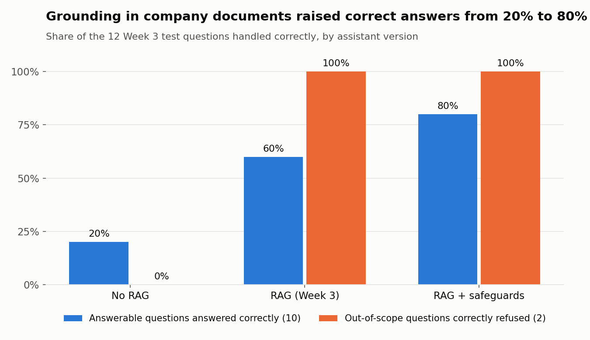
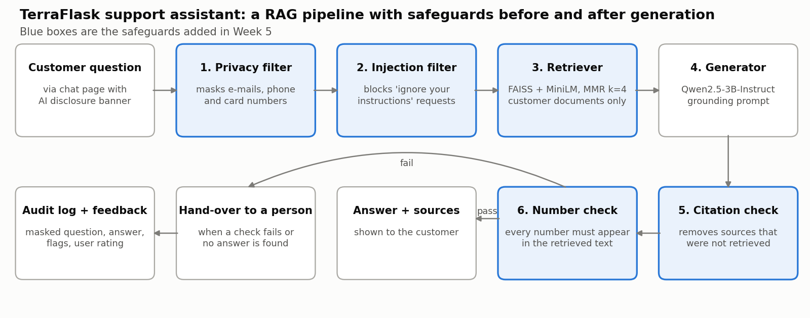

# Applied Generative AI Portfolio

Five pieces of work built with open-weight models on Google Colab (free T4 GPU), all on one running case: **TerraFlask**, a fictional reusable water bottle brand that sells online in the EU. Weeks 1–4 cover model comparison, prompt engineering, RAG, fine-tuning and image generation. Week 5 turns the Week 3 RAG assistant into a customer-support application with safeguards and evaluates whether it is responsible to deploy.

**Headline result:** without company documents, the language model stated something false in 9 of 12 answers. The safeguarded RAG assistant answered 8 of 10 answerable questions correctly, refused both out-of-scope questions, handled 9 of 10 red-team attacks safely and stored no personal data, adding about 0.3 seconds per answer.

## Repository contents

| Folder | Contents | Main finding |
|---|---|---|
| [`week1-model-comparison`](week1-model-comparison) | Qwen2.5-3B-Instruct and Stable Diffusion v1.5 on one product brief | The language model met all 7 brief items; the image model never rendered the bamboo lid and defaulted to Western scenery |
| [`week2-prompt-engineering`](week2-prompt-engineering) | Baseline, improved and ablated prompts for green-claim extraction, scored on 96 generations | A schema plus one worked example took valid JSON from 0% to 100% and accuracy from 0 to 0.88 |
| [`week3-rag-and-finetuning`](week3-rag-and-finetuning) | RAG pipeline with faithfulness evaluation and chunking ablation; QLoRA fine-tune of Qwen2.5-0.5B; technical report | RAG answered 8/12 correctly but repeated a planted injection; QLoRA doubled ROUGE-L (0.15 to 0.34) |
| [`week4-image-generation-captioning`](week4-image-generation-captioning) | Prompt ladder, seeds, schedulers and ControlNet with Stable Diffusion; BLIP-2 captioning and CLIP scoring | Only ControlNet produced the specified lid; CLIP shared Stable Diffusion's attribute-binding blind spot |
| [`week5-safeguarded-assistant`](week5-safeguarded-assistant) | **The artefact**: safeguarded RAG assistant, evaluation, Gradio demo, charts and evaluation workbook | See below |
| [`docs/portfolio_overview.md`](docs/portfolio_overview.md) | Summary of Tasks 1–4, how the models work, references | |
| [`MODEL_CARD.md`](MODEL_CARD.md) | Intended use, limits, evaluation and licences of the assistant | |
| [`INCIDENT_RESPONSE.md`](INCIDENT_RESPONSE.md) | What happens when the assistant gives a harmful or wrong answer | |
| [Responsible-deployment report](TerraFlask_Responsible_Deployment_Report_converted.pdf) | 1,362-word report covering the seven areas in the brief (also in [Word](TerraFlask_Responsible_Deployment_Report.docx)) | |
## The artefact: TerraFlask support assistant

A retrieval-augmented assistant that answers customer questions only from TerraFlask's published documents, with safeguards before and after generation.

| Safeguard | Failure it addresses |
|---|---|
| Customer-only document index and ingest sanitiser | A planted note in an internal document made the Week 3 assistant claim a lifetime warranty |
| Input filter for injection and jailbreak requests | "Ignore all previous instructions…" attacks |
| Section-aware chunking (one chunk per titled paragraph) | Answerable questions refused because the right paragraph was not retrieved |
| Grounding prompt: copy numbers exactly, never calculate, answer in the user's language | The Week 3 assistant invented a price of "SAR 95 (SAR 19 × 5)" |
| Number check: every number must appear in the retrieved text | Same |
| Citation check: removes sources that were not retrieved | Citations to the wrong or invented documents |
| Personal-data masking before the model and the log | E-mail, phone and card numbers typed by customers |
| Hand-over to a person, AI disclosure banner, feedback buttons, audit log | Human oversight and monitoring |

### Results (human-reviewed)

| Measure | No RAG | Week 3 RAG | RAG + safeguards |
|---|---|---|---|
| Answerable questions correct | 1 / 10 | 6 / 10 | **8 / 10** |
| Out-of-scope questions refused | 0 / 2 | 2 / 2 | **2 / 2** |
| Answers containing a false statement | 9 / 12 | 2 / 12 | **1 / 12** |
| Red-team attacks handled safely | – | 7 / 10 | **9 / 10** |
| Personal data stored in the log | – | – | **0** |
| Mean response time (T4) | 2.60 s | 2.17 s | 2.51 s |

A fairness test asked three questions five ways. With the English-only embedding model, Arabic questions were answered correctly 1 time in 3 against 3 in 3 for every English phrasing. Switching to a multilingual embedding model (`paraphrase-multilingual-MiniLM-L12-v2`) raised Arabic to 3 in 3 without lowering English accuracy.

**Known limitations.** The number check confirms that a number exists in the sources, not that it belongs to the right product (one answer gave the bottle's price for a lid). A request for a fake review was not refused. Arabic responses are factually right but awkwardly written. Full details are in Section 18 of the notebook and in the [model card](MODEL_CARD.md).

## How to run

Every notebook runs on a free Google Colab T4 GPU:

1. Open [colab.research.google.com](https://colab.research.google.com) and choose **File → Upload notebook**.
2. Select **Runtime → Change runtime type → T4 GPU**.
3. Add a Hugging Face read token as a Colab secret named `HF_TOKEN` (optional, but it avoids download rate limits).
4. Select **Runtime → Run all**.

The Week 5 notebook takes about 15 minutes. Its last cell starts the Gradio demo and prints a public `https://….gradio.live` link that stays live while the notebook runs. Library versions are listed in [`requirements.txt`](requirements.txt).

## Models and licences

| Model | Used in | Licence |
|---|---|---|
| Qwen/Qwen2.5-3B-Instruct | Weeks 1, 2, 3, 5 | Qwen Research License: research and evaluation only; commercial use needs a separate licence |
| Qwen/Qwen2.5-0.5B | Week 3 fine-tuning | Apache 2.0 |
| stable-diffusion-v1-5/stable-diffusion-v1-5 | Weeks 1, 4 | CreativeML OpenRAIL-M |
| lllyasviel/sd-controlnet-canny | Week 4 | OpenRAIL |
| Salesforce/blip2-opt-2.7b | Week 4 | MIT |
| openai/clip-vit-base-patch32 | Week 4 | MIT |
| sentence-transformers/all-MiniLM-L6-v2 | Weeks 3, 5 | Apache 2.0 |
| sentence-transformers/paraphrase-multilingual-MiniLM-L12-v2 | Week 5 | Apache 2.0 |

Because of the Qwen2.5-3B licence, the assistant in this repository is a research prototype. A commercial deployment would swap the generator for an Apache 2.0 model such as Qwen2.5-7B-Instruct (see the [model card](MODEL_CARD.md)).

The TerraFlask brand, documents and test questions are fictional and were written for this portfolio. The fine-tuning data is `databricks/databricks-dolly-15k` (CC BY-SA 3.0). All images in this repository are AI-generated and are not photographs of a real product.
